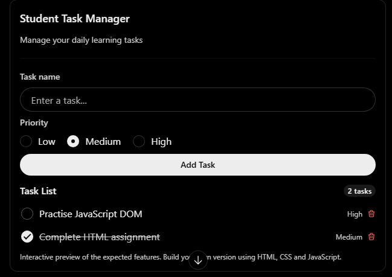

# Module 6: DOM and Events

## 1. Assignment Objective

Create an interactive Student Task Manager using JavaScript DOM manipulation and events. Users should be able to add tasks, mark tasks as completed, delete tasks, and validate form inputs.

The assignment will help you practise selecting HTML elements, modifying content and styles, handling events, validating forms, and debugging JavaScript code.

## 2. Project Requirements

Build a webpage with the following interface.

## Student Task Manager

## 3. Tasks to Complete

### Task 1: Select HTML Elements

Use JavaScript DOM selectors to access the required elements.

- Select the page heading using `getElementById()`.
- Select the task input using `querySelector()`.
- Select all task items using `querySelectorAll()`.
- Display the number of tasks using a suitable DOM selector.

Expected outcome: You can access and work with individual or multiple HTML elements.

### Task 2: Change Text, Attributes and Styles

- Change the page heading to `My Daily Learning Tasks`.
- Display a welcome message when the page loads.
- Change the heading colour when the user clicks a button.
- Update a task's status text to `Completed`.
- Change the task's class or style when it is completed.
- Use `setAttribute()` to update an element attribute.

Expected outcome: The webpage updates dynamically without reloading.

### Task 3: Create and Remove Elements

- Create a new task using `document.createElement()`.
- Add the new task to the task list using `appendChild()` or `append()`.
- Add a Delete button to every task.
- Remove a task when its Delete button is clicked.
- Display `No tasks available` when the list becomes empty.

Expected outcome: Users can add and remove elements dynamically.

### Task 4: Event Listeners

Implement the following event listeners:

| Event              | Required action               |
| ------------------ | ----------------------------- |
| `click`            | Add or delete a task          |
| `change`           | Update task completion status |
| `input`            | Show the current input length |
| `submit`           | Validate and submit the form  |
| `DOMContentLoaded` | Initialize the page           |

Use `addEventListener()` instead of inline HTML event attributes.

### Task 5: Form Input and Validation

Create a form containing:

- Task name — required, minimum 3 characters.
- Priority — Low, Medium or High.
- Due date — optional.

Validation rules:

1. Reject an empty task name.
2. Reject task names shorter than 3 characters.
3. Display an error message beside the invalid field.
4. Prevent form submission when validation fails.
5. Clear the error message when the input becomes valid.
6. Reset the form after successful submission.

### Task 6: Event Objects

Use the event object in at least three event handlers.

- Use `event.preventDefault()` to stop the default form submission.
- Use `event.target` to identify the element that triggered an event.
- Use `event.currentTarget` to identify the element whose handler is running.
- Display the clicked button's text in the browser console.

### Task 7: Event Bubbling and Delegation

Instead of attaching a separate click listener to every Delete button:

- Attach one event listener to the parent task list.
- Detect whether the clicked element is a Delete button.
- Identify the relevant task.
- Remove that task from the list.

Explain in a comment why event delegation is useful when new tasks are added dynamically.

### Task 8: Basic Browser Debugging

Intentionally introduce and debug these issues:

- A misspelled element ID causes `null` to be returned.
- A button does not work because its event listener is missing.
- A task is added twice because duplicate listeners are attached.
- An error occurs when trying to access a property of an undefined element.

For each issue:

1. Open browser developer tools.
2. Check the Console tab.
3. Identify the error or unexpected behaviour.
4. Fix the code.
5. Test the corrected behaviour.

## 4. Deliverables

Submit the following files:

| File         | Description                                            |
| ------------ | ------------------------------------------------------ |
| `index.html` | HTML structure and form                                |
| `style.css`  | Page styling and task states                           |
| `script.js`  | DOM manipulation, events and validation                |
| `README.md`  | Instructions to run the project and brief explanations |

Your application should work in a modern browser without requiring a backend or database.

## 5. Evaluation Criteria

| Criteria                       | Marks |
| ------------------------------ | ----- |
| DOM element selection          | 10    |
| Text, attributes and styles    | 10    |
| Creating and removing elements | 15    |
| Event listeners                | 10    |
| Form validation                | 15    |
| Event objects                  | 10    |
| Bubbling and delegation        | 15    |
| Debugging and code quality     | 15    |
| Total                          | 100   |

## 6. Bonus Challenges

Attempt these after completing the main assignment.

1. Add filters for All, Pending and Completed tasks.
2. Show the total, completed and pending task counts.
3. Save tasks in `localStorage` so they remain after refreshing the page.
4. Add a confirmation before deleting a task.
5. Display a message when all tasks are completed.

Final learning outcome: By completing this assignment, students should be able to build an interactive webpage using JavaScript DOM manipulation, event handling, form validation, event delegation and browser debugging.
